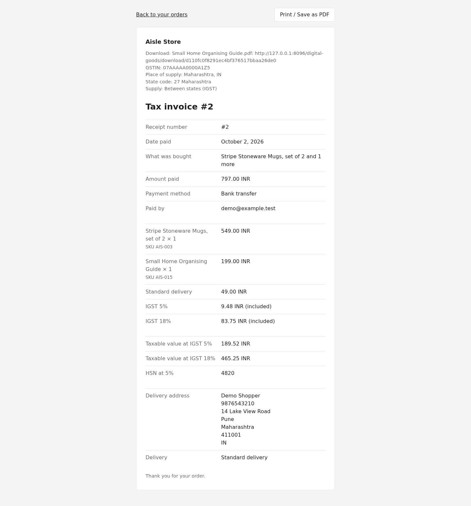

# Tax GST

India GST for the Tax plugin. Tax works out the amounts. This plugin decides how GST is split and what the invoice calls things.

## Requirements

- Tax plugin 0.1 or later, enabled. Without it this plugin does nothing and the admin sees a notice.
- Shopclass 7.1.0 or later, with shop mode
- PHP 8.2 or later

Works on shared hosting. No cron, worker, Redis or shell.

## Install

1. Open Plugins → Browse (or upload the zip from the GitHub release).
2. Install.
3. Activate.

## Set up

There is nothing to set here. Set up Tax first (Billing → Tax):

1. Seller country `IN` and your Seller state, such as Delhi.
2. Seller tax number (your GSTIN) and the rates: a default, and by category with HSN codes.
3. Prices: on for GST-inclusive prices, off to add GST on top.

## How it works

- Buyer in the seller's state: CGST and SGST, each half the rate (18% shows as CGST 9% + SGST 9%).
- Buyer in another state: IGST at the full rate.
- The invoice calls the seller's number GSTIN and the tax codes HSN. It adds the buyer's state code and the kind of supply.
- States are matched by GST state code. "Delhi", "NCT of Delhi" and "New Delhi" are one state, as are "Orissa" and "Odisha". A name that is not an Indian state falls back to Tax's own comparison.
- A buyer with no address yet counts as in the seller's state, so the cart drawer shows CGST + SGST.
- Each line's tax is split in whole rupees by largest remainder, so CGST + SGST always equals the line's GST.

## Notes / limits

- GST applies only to a sale from India to India with the seller's state set. Any other sale keeps Tax's single tax line.
- Not included: buyer GSTIN at checkout, e-invoicing (IRN, QR), reverse charge, cess, composition-scheme rules, sequential invoice numbers, PDF invoices.
- Stores nothing. Orders keep the tax lines they were charged.

## For developers

Listens to Tax's filters `tax_parts` (the CGST, SGST and IGST split) and `tax_invoice` (GSTIN, HSN, state code). It fires no hooks.

Tests: `./tests/run.sh`, or `SHOPCLASS_CORE=../shopclass DRIFT_DB_PORT=33061 ./tests/run.sh` to add the integration test. Tests that need Tax look in `../shopclass-plugin-tax` or `SHOPCLASS_TAX`, and skip without it. Regenerate the template with `php tools/make-pot.php`.

## Support

https://github.com/mindstellar/shopclass-plugin-tax-gst/issues

## License

GPL-3.0-or-later. See [LICENSE](LICENSE).
